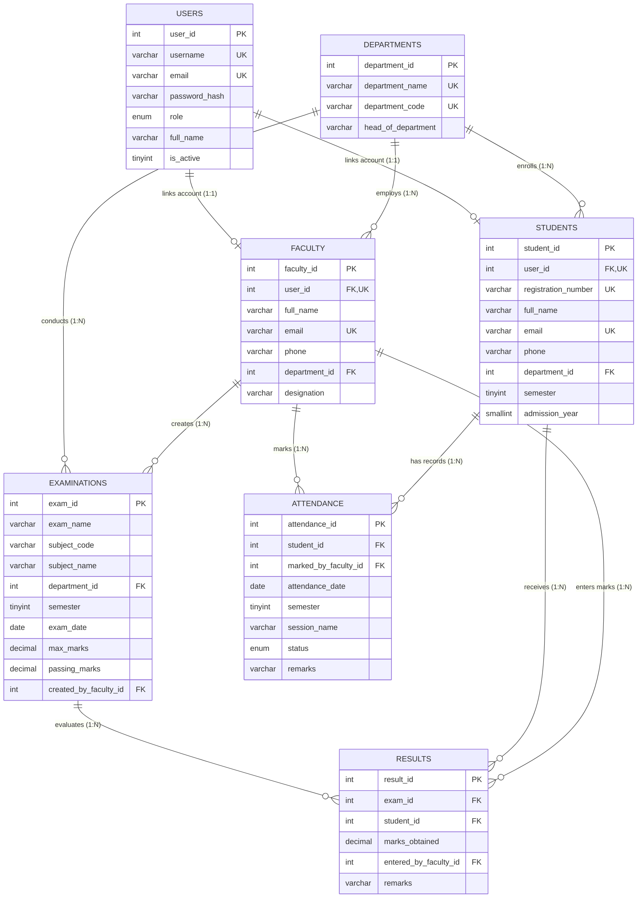

# University Management System (UniPortal ERP)

A full-stack University Management System built from scratch with **Node.js**, **Express.js**, **MySQL 8+**, **HTML5/CSS3**, **Bootstrap 5**, **Chart.js**, and **Vanilla JavaScript** for a college DBMS semester project.

---

## Features & Modules

1. **Authentication & Role Management**
   - Secure session-based login/logout (`express-session`) with `bcrypt` password hashing.
   - Three role-isolated portals: **Admin**, **Faculty**, and **Student**.
   - Backend route guards protecting both HTML pages and REST API endpoints.

2. **Student Management (Admin)**
   - Add, view, edit, delete, and search students by name or registration number.
   - Filter by department and semester, view individual student profiles with attendance & exam history.
   - Enforces unique registration numbers and email addresses across `students` and `users`.

3. **Faculty & Department Management (Admin)**
   - Add, view, edit, and delete faculty members.
   - Create, edit, and safely delete departments; assign Heads of Department and reassign faculty across departments.

4. **Attendance Management (Faculty & Admin)**
   - Faculty view students in their assigned department, pick date/semester/session, mark Present or Absent, and update existing records.
   - Duplicate prevention on `(student_id, attendance_date, session_name)`.
   - Admin & Faculty attendance percentage calculation:
     `Attendance Percentage = (Total Present Classes / Total Conducted Classes) × 100`
   - Filterable attendance records, summary KPIs, CSV export, and print-ready reports.

5. **Examination & Results Management (Faculty, Admin & Student)**
   - Faculty create subject examinations with configurable maximum and passing marks (default 40% threshold), enter and update student marks.
   - Automatic calculation of percentages and `PASS` / `FAIL` status via SQL views and triggers.
   - Admin & Faculty view examination result reports, consolidated student standings, and CSV/print reports.
   - Students view their own subject-wise marks, total marks, overall percentage, and pass/fail status.

6. **DBMS Concepts Demonstration (`dbms-concepts.html`)**
   - Interactive live explorer demonstrating 11 core DBMS topics against `university_management_db`:
     1. Primary Key and Foreign Key
     2. `INNER JOIN`
     3. `LEFT JOIN`
     4. `GROUP BY` and `HAVING`
     5. Aggregate Functions (`COUNT`, `SUM`, `AVG`, `MIN`, `MAX`)
     6. Database Views (`vw_student_attendance_summary`, etc.)
     7. Stored Procedures (`sp_get_department_report`, etc.)
     8. Triggers (`BEFORE INSERT` / `BEFORE UPDATE` integrity & normalization)
     9. Transactions (live `START TRANSACTION` / `UPDATE` / `ROLLBACK` atomicity test)
     10. Indexing (`INFORMATION_SCHEMA.STATISTICS`)
     11. Normalization (1NF, 2NF, 3NF decomposition)

---

## Entity-Relationship (ER) Diagram



---

## Project Structure

```text
university-management-system/
├── frontend/
│   ├── index.html
│   ├── login.html
│   ├── admin-dashboard.html
│   ├── faculty-dashboard.html
│   ├── student-dashboard.html
│   ├── students.html
│   ├── faculty.html
│   ├── departments.html
│   ├── attendance.html
│   ├── examinations.html
│   ├── results.html
│   ├── dbms-concepts.html
│   ├── css/style.css
│   ├── js/
│   └── assets/university-logo.svg
├── backend/
│   ├── server.js
│   ├── config/database.js
│   ├── routes/
│   ├── controllers/
│   ├── middleware/
│   ├── services/
│   ├── tests/
│   └── package.json
├── database/
│   ├── schema.sql
│   ├── sample_data.sql
│   ├── views.sql
│   ├── procedures.sql
│   ├── triggers.sql
│   ├── indexes.sql
│   └── demo_queries.sql
├── .env.example
├── .gitignore
└── README.md
```

---

## Prerequisites & Setup Instructions

### 1. Install Required Software (Without XAMPP)
- **Node.js LTS** (v20+ or v24+): Download from [nodejs.org](https://nodejs.org/).
- **MySQL Server 8.0+**: Download **MySQL Community Server** (and optionally MySQL Workbench / MySQL Shell) from [dev.mysql.com/downloads/mysql](https://dev.mysql.com/downloads/mysql/).
  - During Windows installation, start the MySQL Windows service (`MySQL80`) and note your `root` password.

### 2. Import the MySQL Database Scripts (In Exact Order)
Open a terminal (or MySQL Command Line Client / MySQL Workbench) and execute the SQL files in this exact order:

```bash
mysql -u root -p < database/schema.sql
mysql -u root -p < database/sample_data.sql
mysql -u root -p < database/views.sql
mysql -u root -p < database/procedures.sql
mysql -u root -p < database/triggers.sql
mysql -u root -p < database/indexes.sql
```

*(Note: `schema.sql` automatically creates and selects the `university_management_db` database. `demo_queries.sql` is available for standalone reference or testing in MySQL Workbench.)*

### 3. Configure Environment Variables
Copy `.env.example` to `.env` in the project root (or `backend/.env`) and update your MySQL credentials:

```env
PORT=3000
NODE_ENV=development
SESSION_SECRET=replace_with_a_strong_random_secret

DB_HOST=localhost
DB_PORT=3306
DB_USER=root
DB_PASSWORD=your_mysql_password
DB_NAME=university_management_db
DB_CONNECTION_LIMIT=10
```

### 4. Install Backend Dependencies & Start the Application

```bash
cd backend
npm install
npm start
```

Open your browser and visit:

**http://localhost:3000**

---

## Demo Login Credentials

| Role    | Email                   | Username     | Password      | Scope |
|---------|-------------------------|--------------|---------------|-------|
| Admin   | `admin@university.edu`  | `admin`      | `Admin@123`   | Full system access |
| Faculty | `faculty1@university.edu` | `faculty.cse` | `Faculty@123` | Computer Science & Engineering (CSE) |
| Student | `student1@university.edu` | `reg2024001` | `Student@123` | Aarav Sharma (CSE, Sem 4) |

*(Additional faculty and student accounts in `sample_data.sql` share `Faculty@123` and `Student@123` respectively.)*

---

## Running Automated Backend Tests

```bash
cd backend
npm test
```

